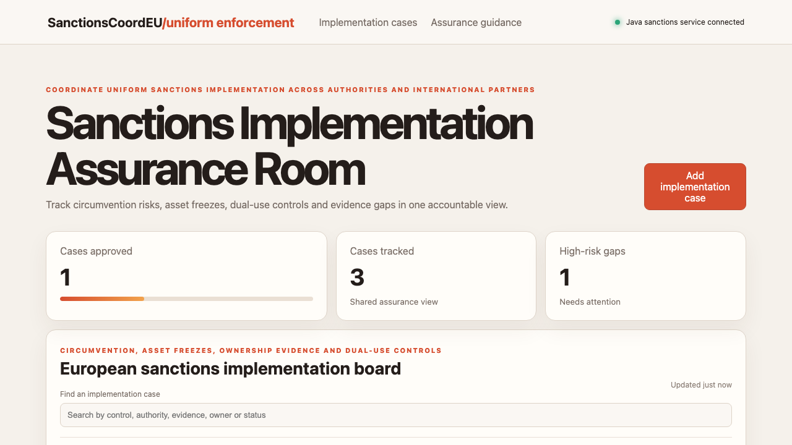

# Sanctions Implementation Assurance Room

## One-sentence benefit
Helps competent authorities coordinate sanctions controls, ownership evidence and cross-border implementation gaps.

## Live demo
Run both layers locally, then follow [the verified application demo](docs/demo.webm).

## Screenshots

## Main features
Search and sort implementation cases, add an escalation, move cases through review and inspect assurance priorities.

## Technology used
Angular, TypeScript, signals, server rendering, Spring Boot and Java.

## Installation instructions
Start `cd backend && mvn spring-boot:run`, then run `npm install && npm start` in another terminal.

## Commercial licensing/contact
Commercial licensing and implementation support are available through the repository owner.

## Business problem and users
Sanctions authorities, customs teams, financial supervisors and enforcement partners need consistent ownership and evidence.

## Key workflows
Filter circumvention cases, add a beneficial-ownership escalation and advance a real backend record through review.

## Angular framework highlights
Standalone components, signals, computed state, built-in control flow, typed HTTP and server rendering are demonstrated.

## Java backend highlights
Spring Boot provides real list, search, create and update endpoints, validation, clear errors, health reporting and tests.

## Architecture and state flow
Angular signals derive the view while HttpClient reads and writes authoritative Java records.

## Accessibility and responsive behaviour
Semantic landmarks, explicit labels, visible focus and responsive grids support keyboard, screen-reader and mobile use.

## Verification commands
Use `npm test -- --watch=false`, `npm run build`, and `cd backend && mvn test package`.

## Structure
`src` contains Angular, `backend` contains Java, and `docs` contains verified media.

## Tradeoffs
The in-memory store keeps setup simple; production needs identity, classified evidence handling and durable audit retention.

## Roadmap
Add authority workspaces, evidence attachments, multilingual decisions, deadline alerts and signed approvals.
